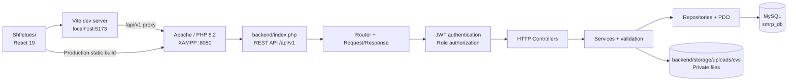

# Arkitektura e SMRP

SMRP eshte aplikacion web me klient React/Vite, API REST ne PHP dhe databaze relacionale MySQL. Frontend-i nuk lidhet direkt me databazen; te gjitha ndryshimet kalojne permes API-se.

## Komponentet

## Organizimi i backend-it

- `backend/index.php` regjistron autoloader-in, CORS-in, rruget dhe trajtimin e gabimeve.
- `backend/core/` permban objektet e kerkese/pergjigjes, router-in dhe gabimet HTTP.
- `backend/app/Http/` permban controllers, middleware dhe validues te kerkesave.
- `backend/app/Services/` permban rregullat e biznesit per autentikim, shpallje, aplikime dhe intervista.
- `backend/app/Repositories/` izolon query-te PDO dhe aksesin ne MySQL.
- `backend/app/Support/` permban JWT, validues dhe ruajtje te sigurt te CV-se.
- `backend/database/schema.sql` krijon databazen dhe tabelat pa fshire rreshta ekzistues.
- `backend/storage/` ruan sekretin lokal JWT dhe CV-te; qasja HTTP direkte bllokohet.

Rrjedha e nje kerkese:

1. Router-i normalizon prefiksin e instalimit dhe gjen metoden/rrugen.
2. Middleware verifikon JWT-ne dhe rolin kur rruga kerkon autentikim.
3. Controller-i lexon input-in dhe therrret sherbimin perkates.
4. Sherbimi validon invariantet e biznesit dhe perdor repository-t.
5. Repository komunikon me MySQL me PDO dhe prepared statements.
6. API-ja kthen JSON me status HTTP perkatës; gabimet e njohura marrin pergjigje te qarte.

## Autentikimi dhe autorizimi

- Fjalekalimet ruhen me hash te pershtatshem per password, jo ne tekst te hapur.
- API-ja leshon JWT me skadim dhe e verifikon ne cdo rruge private.
- Roli `applicant` mund te aplikoje dhe te lexoje te dhenat e veta.
- Rolet `hr` dhe `admin` menaxhojne shpallje, aplikime dhe intervista.
- CV-te nuk sherbehen nga Apache si skedare statike; endpoint-i kontrollon pronarin/rolin dhe kufizon skedarin te dosja private e upload-eve.
- Detajet e brendshme te gabimeve te databazes nuk i kthehen klientit.

## Databaza

Skema aktuale ka kater entitete kryesore: `users`, `jobs`, `applications` dhe `interviews`. Kufizimi unik ne (`user_id`, `job_id`) parandalon aplikime te dyfishta; intervista lidhet me nje aplikim dhe perdoruesin qe e interviston.

## Mjediset

### Zhvillim lokal

1. MySQL dhe Apache nisen nga XAMPP.
2. Vite sherben React ne `http://127.0.0.1:5173`.
3. Proxy i Vite dergon `/api/v1` te Apache/PHP sipas `frontend/vite.config.js`.
4. Nderfaqja mund te hape health check te API-se ne `/api/v1/health`.

### Build statik me XAMPP

`npm run build` shkruan frontend-in te `frontend/public/app-react`. Apache sherben kete direktori si skedare statike; URL-ja relative e API-se shkon te `backend/api/v1`.

## Kufizimet aktuale

- CV-ja ngarkohet dhe shkarkohet ne menyre te autorizuar; analizimi automatik i permbajtjes se CV-se nuk eshte implementuar.
- Njoftimet me email nuk jane pjese e rrjedhes aktuale.
- Perpara publikimit publik duhen HTTPS, konfigurim sekret/DB per prodhim dhe testim i deployment-it real.